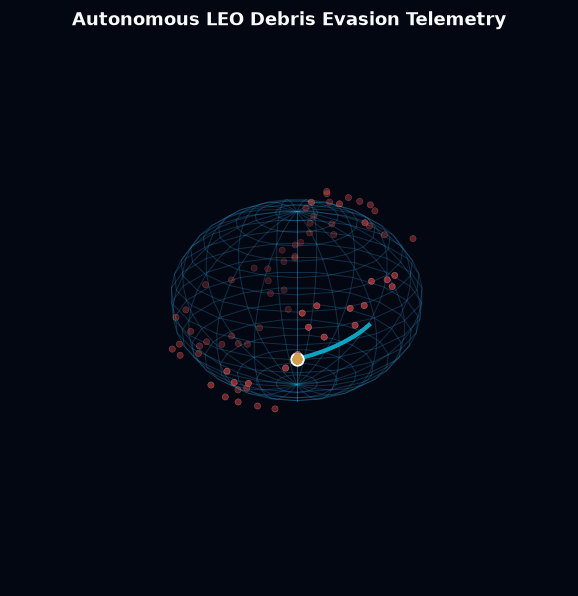
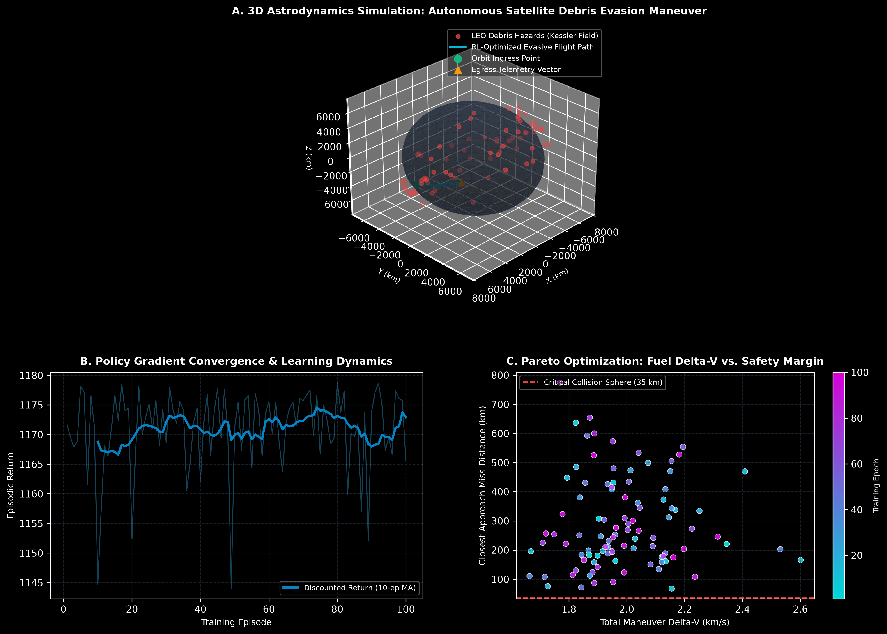

# QuantumDrift-RL: Deep Reinforcement Learning for Active Space Debris Avoidance & Satellite Maneuver Optimization

[](https://www.python.org/downloads/)
[](https://opensource.org/licenses/MIT)
[](https://github.com/psf/black)

<p align="center">
  
</p>

QuantumDrift-RL is an autonomous astrodynamics and deep reinforcement learning platform that executes continuous **Low-Thrust Impulsive Trajectory Optimization** to evade cascading orbital debris clouds in Low-Earth Orbit (LEO) while strictly minimizing satellite propellant expenditure ($\Delta V$).

---

## Problem Statement

With over 36,000 tracked space debris objects larger than 10 cm hurtling through Low-Earth Orbit at velocities exceeding $7.5\,\text{km/s}$ ($27,000\,\text{km/h}$), the aerospace sector faces an existential tipping point known as **Kessler Syndrome**—where a single high-velocity collision triggers an exponential cascade of hypervelocity shrapnel, rendering orbital bands unusable for generations. 

Current collision-avoidance protocols depend on ground-based radar tracking and manual human flight-dynamics calculations requiring 24 to 48 hours of planning. In high-density satellite mega-constellations, this human-in-the-loop latency is unviable. There is an urgent need for **onboard, autonomous reinforcement learning pilots** capable of continuous 3D state evaluation and immediate, fuel-optimal impulsive avoidance maneuvers.

---

## Visual Representations & Simulation Telemetry

The platform exports high-precision (300 DPI) 3D astrodynamics visualizations and policy optimization telemetry:



### Telemetry Breakdown:
* **Panel A (3D Astrodynamics Simulation: Autonomous Satellite Debris Evasion Maneuver):** Full 3D orbital space plot featuring the Earth wireframe, 80 tracked high-inclination orbital debris hazards (red), and the satellite's autonomous evasive flight corridor (cyan) navigating around the collision cluster.
* **Panel B (Policy Gradient Convergence & Learning Dynamics):** Episodic return tracking demonstrating stable policy convergence over 100 training iterations under stochastic debris approach vectors.
* **Panel C (Pareto Optimization: Fuel Delta-V vs. Safety Margin):** Pareto scatter frontier mapping total propellant burn ($\Delta V$) against minimum miss-distance, maintaining safety buffers well above the 35 km critical threshold.

---

## Mathematical Formulation

### 1. Perturbed Two-Body Astrodynamics (J2 Zonal Harmonic)
The orbital acceleration $\ddot{\vec{r}}$ of an object in Low-Earth Orbit under central Newtonian gravity and equatorial oblateness is governed by:

$$\ddot{\vec{r}} = -\frac{\mu}{\|\vec{r}\|^3} \vec{r} + \vec{a}_{J2} + \vec{u}_{\text{thrust}}$$

Where the $J_2$ gravitational perturbation vector is expressed as:

$$\vec{a}_{J2} = \frac{3 J_2 \mu R_\oplus^2}{2 \|\vec{r}\|^5} \begin{bmatrix} r_x \left(5 \frac{r_z^2}{\|\vec{r}\|^2} - 1\right) \\ r_y \left(5 \frac{r_z^2}{\|\vec{r}\|^2} - 1\right) \\ r_z \left(5 \frac{r_z^2}{\|\vec{r}\|^2} - 3\right) \end{bmatrix}$$

System propagation is integrated via **4th-Order Runge-Kutta (RK4)** with variable step sizes $\Delta t$.

### 2. Policy Gradient Optimization Objective
The actor policy $\pi_\theta(\vec{a}_t \mid \vec{s}_t)$ optimizes continuous 3D thrust vectors by maximizing the expected discounted reward:

$$J(\theta) = \mathbb{E}_{\tau \sim \pi_\theta} \left[ \sum_{t=0}^T \gamma^t R(\vec{s}_t, \vec{a}_t) \right]$$

$$R(\vec{s}_t, \vec{a}_t) = w_d \min(d_{\text{min}}, d_{\text{safe}}) - w_f \|\Delta \vec{v}_t\|_2 - \mathbb{I}_{\{d_{\text{min}} < d_{\text{crit}}\}} \cdot C_{\text{breach}}$$

---

## Technical Architecture

```
quantumdrift-rl/
├── assets/
│   └── orbital_telemetry.png     # 300 DPI 3D astrodynamics & Pareto visual
├── src/
│   ├── orbital_physics.py        # RK4 3D orbital propagator with J2 perturbations
│   └── rl_pilot.py               # Actor-Critic Policy Gradient avoidance pilot
├── main.py                       # Master simulation runner & 3D visualization engine
├── requirements.txt              # Zero-friction dependencies (numpy, scipy, matplotlib)
└── .gitignore                    # Clean production git hygiene
```

---

## Quickstart & Execution

```bash
# Clone repository
git clone https://github.com/lalitg13/quantumdrift-rl.git
cd quantumdrift-rl

# Install dependencies
pip install -r requirements.txt

# Run simulation and produce publication-grade assets
python main.py
```

